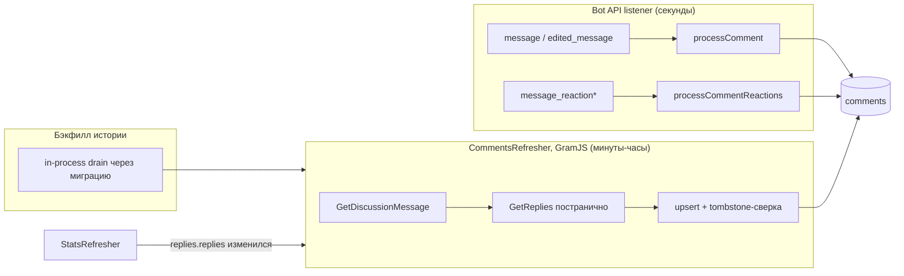

# Сбор комментариев из группы обсуждений — дизайн

**Статус:** реализовано и запущено в production 2026-08-13
**Дата:** 2026-08-13
**Реализация:** PR #85 (комментарии и агрегатные реакции), PR #88 (акторы реакций и `isOwner`)

Исторический backfill доступных Telegram-комментариев завершён. Личности исторических реакторов не бэкфиллились: `commentReactionActors` заполняется только realtime-событиями с момента production-деплоя, а `Comment.reactions` остаётся источником истины для агрегатных счётчиков.

---

## 1. Цель

Сервис уже архивирует посты канала и обновляет их views/reactions. Добавляем сбор **комментариев** из привязанной к каналу группы обсуждений (discussion supergroup), включая **реакции на комментарии**:

- каждый комментарий связывается со своим постом канала;
- новые комментарии ловятся в реальном времени;
- правки, изменения реакций и удаления отслеживаются;
- история комментариев к уже сохранённым постам добирается бэкфиллом;
- сохраняются автор (user / от имени канала / анонимный админ) и метаданные медиа.

## 2. Как это устроено в Telegram (проверено по официальной документации)

| Факт | Уверенность |
|---|---|
| Пост канала автофорвардится в группу обсуждений; у форварда `is_automatic_forward: true` и `forward_origin` (MessageOriginChannel: канал + `message_id` оригинального поста). Это ключ маппинга «корень треда в группе → пост канала». | verified |
| Комментарии несут `message_thread_id`, равный `message_id` корня-автофорварда **в группе** (не id поста канала). Для верхнеуровневого комментария `reply_to_message` указывает на корень; для вложенного — на родительский комментарий. | likely — **проверить эмпирически** (§13) |
| Чтобы бот видел все сообщения группы, его нужно сделать **админом** группы (админы игнорируют privacy mode). Комментарии приходят как `message` / `edited_message` — нужны в `allowed_updates`. | verified |
| Реакции в группе: `message_reaction` (по-пользовательский дифф) и `message_reaction_count` (анонимный агрегат, лаг до минут). Оба требуют бота-админа и явной подписки в `allowed_updates`. Реакции самого бота в `message_reaction` не приходят. | verified |
| **Bot API не присылает событий об удалении сообщений.** Удаления ловим только через MTProto-переопрос. | verified |
| `getChat(@канал)` возвращает `linked_chat_id` — id группы обсуждений. MTProto-аналог: `channels.GetFullChannel → linkedChatId`. | verified |
| MTProto `messages.GetDiscussionMessage(канал, msg_id)` резолвит пост → корень треда в группе. `messages.GetReplies` постранично отдаёт тред (≤100/страницу); GramJS: `iterMessages({replyTo})`. Оба метода — **только для user-сессии** (наш GramJS-синглтон подходит, бот-токен — нет). | verified |
| Сообщения супергруппы, полученные через MTProto, содержат `reactions`, `edit_date`, `from_id`, `reply_to` (msg id + top id), `grouped_id`. **`views` у комментариев нет** — это поле только для постов канала. | verified |
| Счётчик комментариев живёт на **посте канала**: `message.replies.replies`. Он уже есть в ответах `channels.GetMessages`, которые StatsRefresher делает и так — изменение счётчика получаем **бесплатно**. | verified |
| `channels.GetMessages` работает для супергрупп так же, как для каналов (супергруппа — channel-peer в MTProto). | verified |
| Мгновенное удаление можно ловить событием `updateDeleteChannelMessages` на существующем GramJS-клиенте (второй сессии не создаёт). GramJS-репозиторий **архивирован** (июль 2026) — новую поверхность на нём наращиваем минимально; событие оставляем как опцию, периодическая сверка обязательна в любом случае. | verified |

## 3. Архитектура

Три пишущих пути в одну коллекцию `comments`, все идемпотентны (upsert по одному ключу), общие нормализаторы id и реакций:



Разделение ответственности:

- **Realtime (Bot API)** — низкая задержка: новые комментарии, правки, реакции. Ничего не знает про MTProto.
- **CommentsRefresher (GramJS)** — истина в последней инстанции: переобходит треды, досылает пропущенное (даунтайм, отозванные права), подтверждает счётчики реакций, детектит удаления. Клонирует все защиты StatsRefresher (таймауты, FLOOD_WAIT-кап, watchdog).
- **Бэкфилл** — не отдельный процесс, а стартовая миграция, загоняющая все исторические посты в обычную очередь воркера.

## 4. Модель данных

### 4.1 Канонические формы (обязательные для всех писателей)

Критично: realtime пишет из Bot API, воркер — из GramJS, и они обязаны сходиться в **одну** строку по unique-ключу. Поэтому:

- **`discussionChatId` хранится в Bot API-форме** (`-100…`, Number). Все GramJS-писатели нормализуют через единый хелпер:

```ts
// src/telegram/utils/chatId.ts
/** MTProto channel_id (положительный) -> Bot API chat id (-100xxxxxxxxxx). */
export function toBotApiChatId(id: number | bigint | string): number {
  return -(1_000_000_000_000 + Number(id));
}
```

- **Ключи реакций** комментариев — единый нормализатор для обеих форм (Bot API `emoji`/`custom_emoji_id`/paid и GramJS `emoticon`/`documentId`/`reactionPaid`):

```ts
// src/telegram/processors/reactionKey.ts
// обычный эмодзи -> сам эмодзи; кастомный -> `custom:<id>`; платный -> `paid`
```

  Существующий формат ключей у **постов** (JSON.stringify для кастомных) не трогаем — иначе откат начнёт чередовать два формата в одном поле. Унификация постов — отдельная задача с миграцией, вне скоупа.

### 4.2 Коллекция `comments` (новая, `src/db/models/Comment.ts`)

Отдельная коллекция, не встраивание в Post: фан-аут неограничен (сотни комментариев × entities × media), у комментариев своя частота записи, и запросы «тред целиком» / «сироты» не выражаются во встроенном массиве без аггрегаций.

```ts
interface IComment {
  // identity
  discussionChatId: number;      // Bot API форма (-100…)
  messageId: number;             // id сообщения в группе

  // linkage — натуральные ключи, как везде в кодовой базе (populate не используем)
  channelId: string | null;      // username канала; null у сироты до резолва
  postTelegramId: number | null; // id поста канала; null до резолва маппинга
  threadRootId: number;          // id корня-автофорварда В ГРУППЕ (= message_thread_id)
  parentCommentId: number | null;// id комментария-родителя; null = верхний уровень
                                 // (правило: reply_to нет ИЛИ reply_to.id === threadRootId => null)

  author: {
    id: number | null;           // user id или sender_chat id
    type: 'user' | 'channel' | 'group_anonymous';
    username: string | null;
    firstName: string | null;
    lastName: string | null;
    title: string | null;        // для channel / group_anonymous
    isBot: boolean;
  };

  text: string;
  entities: unknown[];           // смешанная политика Bot API / GramJS — как у Post
  media: MediaItem[];            // переиспользуем существующий MediaItem

  reactions: IReaction[];        // flat: у комментариев нет views, обёртка stats не нужна
  date: Date;
  editedAt: Date | null;
  deletedAt: Date | null;        // tombstone; НИКОГДА не hard-delete
  lastSyncedAt: Date | null;     // штамп последней сверки воркером
  createdAt: Date;
  updatedAt: Date;
}
```

Индексы:

```ts
// identity — цель upsert'а всех писателей
{ discussionChatId: 1, messageId: 1 }  // unique
// «все комментарии поста по порядку» — экспорт, пересчёт счётчика
{ channelId: 1, postTelegramId: 1, date: 1 }
// обход треда воркером и diff для tombstone
{ discussionChatId: 1, threadRootId: 1, messageId: 1 }
// очередь сирот (partial)
{ discussionChatId: 1, threadRootId: 1 }  // partialFilterExpression: { postTelegramId: null }
```

`nextRefreshAt` у комментария **нет** — расписание живёт на посте (§6.3): единица работы воркера — обход целого треда, per-comment расписание было бы N триггеров одного и того же обхода.

Tombstone вместо удаления: это архивный инструмент — факт удаления сам по себе сигнал; занятый unique-слот защищает от «воскрешения» дублем; повторный проход, увидевший комментарий снова, снимает `deletedAt` (самовосстановление от ложных срабатываний).

### 4.3 Расширение `Post` — единый суб-документ `discussion`

Один поддокумент, одна state-машина, оба писателя работают с одними путями:

```ts
discussion: {
  chatId:        { type: Number, default: null },  // Bot API форма
  rootMessageId: { type: Number, default: null },  // корень треда в группе
  state:         { type: String, enum: ['pending', 'linked', 'none', 'gone'], default: 'pending' },
  commentsCount: { type: Number, default: 0 },     // кэш message.replies.replies
  resolveAttempts:        { type: Number, default: 0 },
  lastCommentsRefreshedAt:{ type: Date, default: null },
  nextCommentsRefreshAt:  { type: Date, default: null },
}
```

Состояния: `pending` — корень не найден (очередь бэкфилла) → `linked` — корень известен; `none` — комментарии недоступны (выключены / пост старше привязки группы, MSG_ID_INVALID) — терминально; `gone` — корень удалили, тред tombstoned — терминально. **Пост с 0 комментариев — это `linked`, не `none`**: поздние комментарии должны находиться.

Индексы Post: `{'discussion.chatId': 1, 'discussion.rootMessageId': 1}` (маппинг тред→пост на горячем пути realtime), `{'discussion.nextCommentsRefreshAt': 1}` (очередь воркера), partial `{'discussion.state': 1}` по `state: 'pending'`.

### 4.4 Единая стартовая миграция

Одна `runInitMigration()` в CommentsRefresher (стиль StatsRefresher), **гейтится флагом `COMMENTS_ENABLED`** — деплой с выключенной фичей не мутирует базу:

```ts
await Post.updateMany(
  { discussion: { $exists: false } },
  { $set: { discussion: { chatId: null, rootMessageId: null, state: 'pending',
      commentsCount: 0, resolveAttempts: 0, lastCommentsRefreshedAt: null,
      nextCommentsRefreshAt: new Date() } } }   // ⚠ now, не null — иначе очередь пуста и бэкфилл не стартует
);
```

## 5. Realtime-слой (Bot API listener)

### 5.1 `allowed_updates` и роутинг

```ts
allowed_updates: ['channel_post', 'edited_channel_post',
                  'message', 'edited_message',
                  'message_reaction', 'message_reaction_count']
```

(node-telegram-bot-api 0.66 эмитит оба reaction-события; типы 0.64 отстают — понадобятся структурные локальные типы + фикстурные тесты на реальные JSON-формы.)

**Роутинг реакций — только позитивная идентификация.** Сейчас `processReactionUpdate` ищет пост по `{telegramId}` без фильтра чата; message_id канала и группы — независимые последовательности, и апдейт из группы может перезаписать реакции поста с совпавшим id. Исправление — частью этой фичи, оба изменения обязаны заехать вместе:

```ts
bot.on('message_reaction_count', async (u) => {
  const update = u as ReactionCountUpdate;
  if (update.chat.username === config.telegram.channelName) {
    await processReactionUpdate(update);            // канал — как раньше
  } else if (update.chat.id === await ensureDiscussionChatId(bot)) {
    await processCommentReactionCount(update);      // группа обсуждений
  } else {
    console.warn('[Reactions] апдейт из неопознанного чата, дропаем:', update.chat.id);
  }
});
```

Плюс защита в самом `processReactionUpdate`: фильтр `channelId: update.chat.username` и явный `if (!update.chat.username) return` (Mongoose молча выбрасывает undefined из фильтра — приватная группа без username иначе снова деградирует фильтр до `{telegramId}`).

### 5.2 Обнаружение группы обсуждений — один модуль на оба стека

`src/telegram/discussion.ts` — единственный источник истины для realtime и GramJS-воркера:

- Bot API-путь: `bot.getChat('@' + channelName).linked_chat_id`.
- GramJS-путь: `channels.GetFullChannel → linkedChatId` + InputPeer из `chats`.
- Хранит обе формы id (`-100…` и голую MTProto) из одного резолва.
- `DISCUSSION_CHAT_ID` (env, опционально) переопределяет **оба** пути; валидация формата на старте: положительное число отвергается с подсказкой про `-100…` (или автоконверсия с warn).
- Резолв — **на старте с ретраем по таймеру** (не лениво от первого сообщения: иначе после рестарта на тихой группе реакции молча дропаются неограниченно долго), кулдаун 60 с, без exit — сервис деградирует, но живёт.
- Стартовая самопроверка: `getChatMember(groupId, botId)` — если бот не админ, громкий `console.error` («реакции и комментарии не будут приходить, остаётся только GramJS-рефрешер»).
- Лог при резолве печатает id в обеих нотациях — чтобы grep-ом убедиться, что оба воркера смотрят на один чат.

### 5.3 Корень-автофорвард → маппинг на пост

`processDiscussionRoot(msg)` при `is_automatic_forward`:

1. Из `forward_origin` берём `(channelUsername, postTelegramId)`; `rootMessageId = msg.message_id`, `chatId = msg.chat.id`.
2. `Post.updateOne({telegramId, channelId}, {$set: {'discussion.chatId', 'discussion.rootMessageId', 'discussion.state': 'linked'}})`.
3. Если пост ещё не сохранён (processPost качает медиа) — ретрай-лесенка 2с/10с/30с in-memory; не сработала — оставляем воркеру (он резолвит `pending` через GetDiscussionMessage).
4. После успешного линка — подцепить сирот: `Comment.updateMany({discussionChatId, threadRootId, postTelegramId: null}, {$set: {postTelegramId, channelId}})`.

Стаб-посты не создаём: владелец создания Post — processPost/история.

### 5.4 Обработка комментария — позитивная проверка треда

Наивный фильтр «есть `message_thread_id` → комментарий» пропускает в базу обычные реплай-цепочки участников группы (у них тоже есть thread id) — вечные сироты. Принимаем сообщение как комментарий, только если корень треда позитивно опознан:

1. `reply_to_message` — это корень с `is_automatic_forward` (заодно мгновенный self-resolve `postTelegramId` из его `forward_origin`); или
2. `message_thread_id` совпадает с известным `Post.discussion.rootMessageId`; или
3. корень в маленьком in-memory буфере «свежие корни» (гонка: комментарий пришёл раньше, чем п.5.3 дописал маппинг) — буфер ограничен (например, 200 записей / TTL 10 мин), по TTL сбрасывается: пропущенное доберёт воркер.

Иначе — drop с debug-логом. Сервисные сообщения отсекаются позитивным контент-чеком (`text|caption|photo|video|animation|document|audio|voice|video_note|sticker|poll`).

Сам обработчик — идемпотентный upsert по `(discussionChatId, messageId)`; правка (`edited_message`) — тот же путь с `editedAt`; правка невиданного комментария просто вставляет его (бесплатный ремонт пропусков). У сироты `channelId`/`postTelegramId` остаются null до резолва — ничего не хардкодим. Гонка двух upsert'ов (realtime против воркера) даёт E11000 — один ретрай, вторая попытка становится обычным update.

**Медиа комментариев:** метаданные — всегда; скачивание файлов — за флагом `COMMENTS_DOWNLOAD_MEDIA` (default **false**: объём большой, ценность ниже постов). Рефакторинг `processMediaBot.ts`: извлечь `downloadViaBot()`, добавить опции `{baseDir, download}` (поведение для постов не меняется), файлы комментариев — в `media/<channel>/comments/<threadRootId>/`. На edit медиа не перекачиваем.

### 5.5 Реакции на комментарии

- **`message_reaction`** (основной в группе, по-пользовательский дифф): оптимистичный фолд в `Comment.reactions` (декремент old, инкремент new, ключи через `reactionKey()`), и **подтягивание сверки**: `Post.updateOne({'discussion.chatId', 'discussion.rootMessageId': comment.threadRootId}, {$set: {'discussion.nextCommentsRefreshAt': new Date()}})` — воркер подтвердит точные счётчики ближайшим тиком. (Фолд дрейфует на пропущенных апдейтах — сверка обязательна, и она должна дёргать поле, которое воркер реально читает.)
- **`message_reaction_count`** (анонимный агрегат): авторитетная перезапись `reactions` целиком — зеркало существующего `processReactionUpdate`, но по ключу комментария.
- Реакция на несуществующий ещё комментарий — warn и drop; скелетов из реакций не создаём.
- Бот не админ → оба типа не приходят вовсе; корректность сохраняет воркер, деградирует только задержка.

### 5.6 Рестарты и пропуски

Telegram хранит неподтверждённые long-polling-апдейты ~24 часа и повторно отдаёт их после реконнекта — рестарты короче суток теряют ноль (все пути записи идемпотентны, реплей безвреден). Даунтайм >24ч закрывают: коуплинг по `replies.replies` (§6.4), обычное расписание воркера и upsert-on-edit. Удаления realtime не видит вообще — это целиком зона воркера.

## 6. CommentsRefresher (GramJS-воркер)

### 6.1 Отдельный воркер + общий каркас

Отдельный от StatsRefresher: другая единица работы (тред ≈ 2–7 вызовов против 1 вызова на 100 постов), другая лесенка/cutoff, свой kill switch, изоляция отказов. Общие хелперы (`envNumber`, `withTimeout`, `runStage`, `getFloodWaitSeconds`, `isChannelInvalid`) выносятся в `refreshShared.ts`; StatsRefresher переводится на импорт из него — **существующий `statsRefresher.spec.ts` обязан пройти без изменений** (регрессионный гейт рефакторинга).

### 6.2 Один GramJS-клиент на двоих: gate + stagger

Жёсткое ограничение соблюдено: **ни нового клиента, ни новой сессии** — оба воркера ходят через `getGramClient()`.

```ts
// src/telegram/client/gramGate.ts — промис-цепочка, сериализующая MTProto-вызовы
export function runExclusive<T>(tag: string, op: () => Promise<T>): Promise<T>
```

- Таймаут оборачивает invoke **внутри** гейта: зависший навсегда GramJS-промис (сценарий #81) отваливается по таймауту, гейт освобождается, второй воркер не блокируется навечно.
- **Внутри гейта — только сам invoke**: все sleep'ы между страницами и записи в Mongo — снаружи, иначе комментарный тик держит полосу вдвое дольше нужного.
- Ожидание гейта логируется при превышении порога (`[gramGate] waited 42s (holder: CommentsRefresher/GetReplies)`) и **не входит** в stage-таймаут StatsRefresher — иначе его watchdog кричит «stuck» на здоровой очереди.
- Первый тик комментариев сдвинут на `COMMENTS_REFRESH_STAGGER_MS` (default 150 000 = полтика статистики), чтобы тикеры не стреляли залпом.

Бюджет: статистика 1–2 вызова + комментарии ~6–12 вызовов на 5 минут — с большим запасом под флуд-порогами.

### 6.3 Тик (каркас StatsRefresher: re-entrancy guard, watchdog, те же формулировки логов)

```
runTick():
  выбрать до POSTS_PER_TICK (default 5) постов:
    discussion.nextCommentsRefreshAt <= now, state in [pending, linked],
    $or: [ date >= cutoff, discussion.lastCommentsRefreshedAt == null ]   // backfill-ветка, зеркало StatsRefresher
    сортировка по nextCommentsRefreshAt — без голодания
  для каждого поста последовательно: refreshPostComments(post)
    FLOOD_WAIT > капа → прервать ВЕСЬ тик (флуд глобален для сессии), сдвинуть расписание остальных
```

`refreshPostComments(post)`:

1. **Резолв корня** (только `state == 'pending'`; realtime обычно успевает раньше): `GetDiscussionMessage` → корень по `fwdFrom.savedFromMsgId`; `MSG_ID_INVALID` → `state='none'`, парк; пусто — `resolveAttempts++`, после 3 попыток парк.
2. **Обход треда** — сырой `messages.GetReplies` постранично (не iterMessages: каждой странице нужен свой `runStage`-таймаут), limit 100, `offsetId` от **сырого** минимального id страницы; терминация — по **сырой** длине страницы (<100), не по отфильтрованной (страница из одних service-сообщений не должна досрочно «завершать» обход); cap `THREAD_FETCH_LIMIT` (500) → частичный проход.
3. **Upsert** через `bulkWrite`: users/chats-мапы **аккумулируются по всем страницам** (не только последней); `author` — только не-null поля точечными `$set`-путями (min-populated ответы не затирают то, что знает realtime); контент — с монотонным гардом по `editedAt` (не откатывать более свежую realtime-правку снапшотом, снятым до неё); реакции — last-writer-wins (воркер авторитетен).
4. **Tombstone-сверка** — только по полностью наблюдённому окну:

```
filter = { discussionChatId, postTelegramId, deletedAt: null,
           messageId: { $nin: fetchedIds, $lte: maxFetchedId } }   // пришедшее mid-pass (id > max) не судим
если проход частичный: += $gte: minFetchedId                       // не заглядывали ниже — не трогаем
пусто при knownCount > 0 → аномалия: пропустить сверку, warn
тред реально пуст (knownCount == 0): tombstone только date < walkStartedAt   // не задеть вставленное realtime во время обхода
MSG_ID_INVALID на GetReplies → state='gone', tombstone всего треда, парк
```

5. **Продвижение**: `commentsCount = page.count`, `lastCommentsRefreshedAt = now`, `nextCommentsRefreshAt` по лесенке.

### 6.4 Расписание и связка со StatsRefresher

Лесенка по **эффективному возрасту** `max(post.date, дата последнего сохранённого комментария)` — живой тред на старом посте не выпадает из расписания:

| возраст | интервал |
|---|---|
| < 1 ч | 10 мин |
| < 6 ч | 30 мин |
| < 24 ч | 2 ч |
| < 3 дн | 6 ч |
| < 7 дн | 24 ч |
| < 14 дн | 48 ч |
| < 30 дн | раз в неделю |
| ≥ 30 дн | парк (`null`) |

Ранние ярусы реже статистических — воркер тут только сверщик, новизну несёт realtime.

**Обязательная (не опциональная) связка:** StatsRefresher уже получает `message.replies.replies` в своих ответах. Если счётчик ≠ `discussion.commentsCount` **и** `discussion.lastCommentsRefreshedAt != null` (пост уже прошёл первичный бэкфилл — иначе очередь и так его держит) → `nextCommentsRefreshAt = now`. Это demand-driven пробуждение запаркованных и далёких по расписанию постов ценой нуля дополнительных MTProto-вызовов. Ограничение: посты старше 30-дневного cutoff статистики не опрашиваются ею — для них поздние комментарии не обнаруживаются; принимаем (согласуется с текущей политикой стат).

## 7. Бэкфилл истории

**Основной путь — без отдельного скрипта.** Миграция (§4.4) ставит всем историческим постам `state='pending'`, `nextCommentsRefreshAt=now`; обычные тики дренируют очередь: ~5 постов/тик × 12 тиков/час ≈ 60 постов/час ≈ **несколько сотен постов за одну ночь**, с нулевым риском для сессии. Прогресс виден по `tick done`-логам.

**Скрипт-ускоритель `npm run comments:backfill` — только запасной выход.** Отдельный процесс на том же `STRING_SESSION` — это территория `AUTH_KEY_DUPLICATED` (обе сессии инвалидируются, восстановление — интерактивный релогин на проде). Правила, зашитые в скрипт и README:

- запускается **только** через compose, чтобы не разъезжались env и не жил второй процесс:
  ```bash
  docker compose stop helper && \
  docker compose run --rm helper node dist/telegram/client/backfillComments.js && \
  docker compose up -d helper
  ```
- lock-файл в `./data/` (bind-mounted том — виден и хосту, и контейнеру);
- стартовый баннер с предупреждением и sleep 10 с до первого MTProto-вызова;
- пре-скан через `channels.GetMessages` батчами по 100 (`replies.replies == 0` → пост пропускается, но `state` остаётся `linked`, не терминальный) — на ~1000 постов это ~610 вызовов вместо ~2000, т.е. **~15 минут**;
- резюмируемость: пропуск постов с `lastCommentsRefreshedAt != null`;
- wall-clock-кап (`COMMENTS_BACKFILL_MAX_RUNTIME_MIN`, default 120) — скрипт резюмируемый, выйти дёшево; помнить: пока сервис остановлен, **не пишутся и посты канала**, бюджет остановки ≪ 24 ч.

## 8. Конфигурация (все новые env, дефолты)

| Переменная | Default | Что делает |
|---|---|---|
| `COMMENTS_ENABLED` | `true` | единый kill switch: handlers + allowed_updates, воркер, миграция, связка со StatsRefresher |
| `DISCUSSION_CHAT_ID` | — | override обнаружения группы (форма `-100…`; действует на **оба** стека) |
| `COMMENTS_DOWNLOAD_MEDIA` | `false` | скачивать файлы медиа комментариев (метаданные — всегда) |
| `COMMENTS_REFRESH_TICK_MS` | `300000` | период тика воркера |
| `COMMENTS_REFRESH_STAGGER_MS` | `150000` | сдвиг первого тика от StatsRefresher |
| `COMMENTS_REFRESH_POSTS_PER_TICK` | `5` | тредов за тик |
| `COMMENTS_REFRESH_THREAD_FETCH_LIMIT` | `500` | max комментариев за проход треда |
| `COMMENTS_REFRESH_PAGE_GAP_MS` | `1000` | пауза между страницами/постами |
| `COMMENTS_REFRESH_GRAM_TIMEOUT_MS` | `30000` | дедлайн на MTProto-вызов |
| `COMMENTS_REFRESH_FLOOD_WAIT_MAX_S` | `300` | FLOOD_WAIT выше капа ⇒ прервать тик |
| `COMMENTS_REFRESH_STUCK_TICKS_WARN` | `3` | порог watchdog |
| `COMMENTS_REFRESH_CUTOFF_DAYS` | `30` | горизонт лесенки |
| `COMMENTS_RESOLVE_MAX_ATTEMPTS` | `3` | попыток GetDiscussionMessage до парковки |
| `COMMENTS_BACKFILL_POST_GAP_MS` | `1500` | скрипт: пауза между постами |
| `COMMENTS_BACKFILL_DOWNLOAD_MEDIA` | `false` | скрипт: качать медиа |
| `COMMENTS_BACKFILL_MAX_RUNTIME_MIN` | `120` | скрипт: wall-clock-кап |

Плюс гигиена: добавить `CHANNEL_USERNAME` в `.env.example` (сейчас молча падает на хардкод `stonksnws` в `config/telegram.ts`); один `envBool`-хелпер рядом с `envNumber`; единый формат grep-команд в README (`docker compose logs helper`).

## 9. Наблюдаемость

Префиксы `[Comments]` (realtime), `[CommentsRefresher]`, `[CommentsBackfill]`, `[gramGate]`. Ключевые строки:

```
[CommentsRefresher] tick: 5 due posts (2 pending, 3 linked)
[CommentsRefresher] post stonksnws#123: +3 new, 41 upserted, 1 tombstoned, count=44 (pages=1, partial=no)
[CommentsRefresher] tick done: posts=5 upserted=87 tombstoned=1 skipped=0 in 6412ms
[CommentsRefresher] comments unavailable for stonksnws#95 (MSG_ID_INVALID), parking
[CommentsRefresher] FLOOD_WAIT 420s exceeds cap 300s, aborting tick (3 posts deferred)
[gramGate] waited 42s for lane (holder: CommentsRefresher/GetReplies)
```

Диагностика (расширение README-раздела):

```bash
docker compose logs helper | grep '\[CommentsRefresher\] tick done'    # heartbeat + пропускная способность
docker compose logs helper | grep 'worker looks stuck'                 # watchdog обоих воркеров (сообщение называет виновника)
docker compose logs helper | grep FLOOD_WAIT                           # флуд-давление
docker compose logs helper | grep 'skipping tombstone'                 # аномалии deletion-гарда (должно быть пусто)
```

В `tick done` включается признак `idle=no-linked-group`, чтобы «нет привязанной группы» было видно на каждом тике, а не одной строкой на старте.

## 10. Деплой (прод: `nick@MacBook-Pro-Lab.local`, Docker compose)

### 10.1 Ручные шаги в Telegram (однократно, до деплоя)

1. У канала должна быть привязана группа обсуждений (Настройки канала → Обсуждение). *Со слов владельца — уже есть.*
2. Добавить бота в группу и **повысить до админа со всеми правами выключенными** — голого статуса админа достаточно и для privacy-mode-байпаса, и для `message_reaction*`; прав на удаление/бан/пост не давать.
3. Если группа приватная: **аккаунт юзербота** (тот, что за `STRING_SESSION`) должен быть её участником — иначе `GetReplies` вернёт `CHANNEL_PRIVATE`, и воркер молча запаркует все посты при работающем realtime (сплит-брейн, который заметен только по логам). На старте воркер делает одну пробную `GetDiscussionMessage` по свежему посту и логирует `CHANNEL_PRIVATE` человеческим текстом: «юзербот не участник приватной группы обсуждений».

### 10.2 Порядок деплоя

```bash
ssh nick@MacBook-Pro-Lab.local
cd <workspace>/helper && git pull
# .env: добавить COMMENTS_ENABLED=true (+ overrides при желании)
npm run docker:start
docker compose logs helper -f   # ждать: '[Discussion] группа найдена', 'init migration', первый 'tick done'
```

Миграция идемпотентна и гейтится флагом; первый полный дрен исторических постов займёт часы (см. §7) — индикатор прогресса — строки `tick done`.

### 10.3 Откат

`git checkout <old-sha> && npm run docker:start`. Что важно знать:

- Сбор комментариев останавливается; при ролл-форварде пропуск добирается воркером (расписание + связка по `replies.replies`). Ролл-форвард желателен в пределах дней, не недель.
- `allowed_updates` — sticky на боте: старый код передаст старый список, группа перестанет приходить — ожидаемо и обратимо.
- Формат ключей реакций постов не менялся (§4.1) — откат не чередует форматы.

### 10.4 Dev-безопасность (двойной запуск)

Тестировать комментарии хочется на реальной группе, и это главный путь к аварии: два поллера на одном боте (409 + апдейты делятся между процессами) и два клиента на одном `STRING_SESSION` (`AUTH_KEY_DUPLICATED`). Правила в README + дешёвый предохранитель:

- dev — **только** со вторым ботом BotFather (админ тестовой группы) и отдельной `STRING_SESSION`;
- флаг `BOT_POLLING_ENABLED=false` — запуск воркеров без поллинга (работа с дампом);
- warn + sleep 10 с на старте при `NODE_ENV=DEV` с заполненной прод-сессией.

## 11. Тесты (vitest, стиль statsRefresher.spec.ts)

- **Кросс-писательские инварианты (merge-гейты):** один и тот же комментарий, записанный realtime-путём и воркером, даёт **ровно один документ**; Bot API `custom_emoji_id` и GramJS `reactionCustomEmoji` с одним document_id дают **идентичный ключ** `reactionKey()`.
- `commentsAgeTiers.spec.ts`: границы ярусов, эффективный возраст (свежий комментарий на старом посте), cutoff → null.
- `gramGate.spec.ts`: сериализация; отклонённый op не отравляет цепочку; **зависший op, обёрнутый в таймаут, освобождает гейт**.
- `processComment.test.ts`: позитивный гард треда (чужой реплай-чейн — drop); линк корня + ретраи; резолв сирот; self-resolve через `reply_to_message.forward_origin`; сервисные сообщения; edit-upsert; E11000-ретрай.
- `commentsRefresher.spec.ts`: резолв pending; MSG_ID_INVALID → `none`; полный/частичный обход и точные границы tombstone-фильтра (`$lte max` всегда, `$gte min` при partial); пустой тред + `walkStartedAt`-граница; аномальный пустой fetch при count>0 → сверка пропущена; `gone` + тотальный tombstone; FLOOD_WAIT в капе (retry) и выше капа (abort tick); зависший GetReplies (зеркало сьюта #81); watchdog; parent-маппинг; аккумуляция users по страницам; монотонность `editedAt`.
- Существующий `statsRefresher.spec.ts` проходит без изменений после выноса `refreshShared.ts` и внедрения гейта.

## 12. План реализации (4 последовательных PR)

1. **Фундамент** — типы, `Comment`-модель, `Post.discussion`, `chatId.ts`, `reactionKey.ts`, модуль `discussion.ts`, миграция за флагом. Ничего ещё не пишет в прод-поток.
2. **Realtime** — listener (`allowed_updates`, позитивный роутинг реакций + фикс `processReactionUpdate`), `processComment`, `processCommentReactions`, рефакторинг `processMediaBot`, тесты.
3. **Воркер** — вынос `refreshShared.ts` (регрессионный гейт), `gramGate`, `commentsAgeTiers`, `commentsRefresher`, связка в StatsRefresher, wiring в `index.ts`, тесты.
4. **Хвосты** — экспорт (комментарии в JSON поста + `orphanComments`, заодно фикс путей копирования медиа в `export.ts`), скрипт бэкфилла, `.env.example`, README (env-таблица, runbook, rollback, dev-safety, grep-диагностика).

## 13. Проверить эмпирически (одним тестовым комментарием, до/в начале PR 2)

1. `message_thread_id` комментария == `message_id` корня-автофорварда в группе (факт уровня «likely»).
2. Форма `reply_to_message` у верхнеуровневого комментария (присутствует и указывает на корень с `forward_origin`? иначе self-resolve не сработает — не критично, но знать надо).
3. Приходит ли `message_reaction_count` в группе вообще (дизайн работает и без него — но подтвердить).
4. `GetDiscussionMessage` для старого поста, опубликованного до привязки группы: ошибка или пусто (влияет на ветку `none` в бэкфилле).

## 14. Открытые решения (дефолты выбраны, можно передумать)

| Решение | Выбранный дефолт |
|---|---|
| Скачивать медиа комментариев | Нет (метаданные — да); флаг `COMMENTS_DOWNLOAD_MEDIA` |
| Хранить удалённые комментарии | Да, tombstone `deletedAt` (архивный инструмент) |
| Реакции по-пользовательски (кто поставил) | Не храним — только агрегаты, как у постов; `message_reaction` несёт актора, дверь открыта |
| Событие `updateDeleteChannelMessages` (мгновенные удаления) | Не в первой итерации: GramJS архивирован, периодическая сверка обязательна в любом случае; спайк — потом |
| Общий формат ключей реакций для постов | Не трогаем (только комментарии на `reactionKey()`); унификация постов — отдельная задача |
